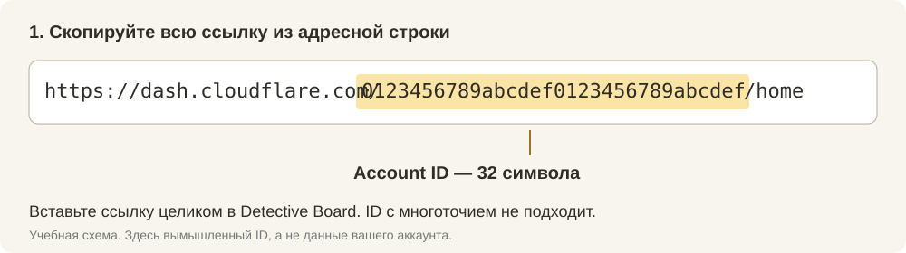
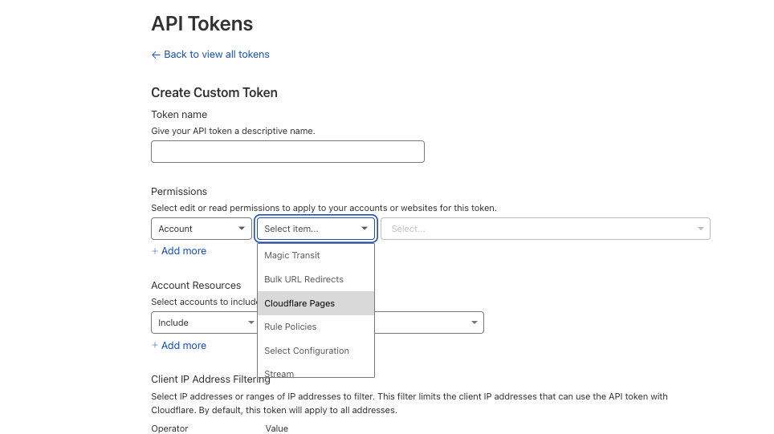
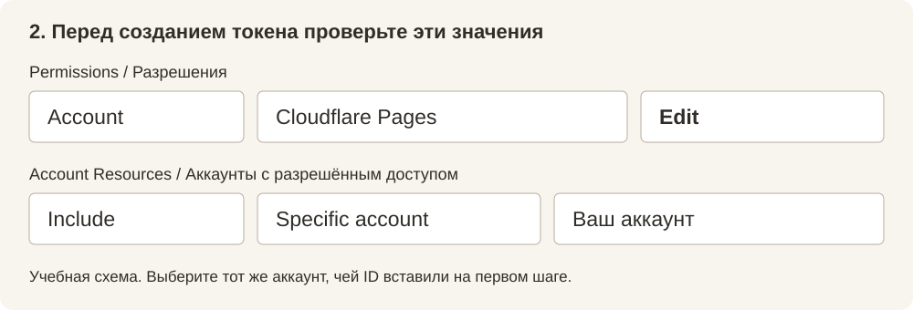
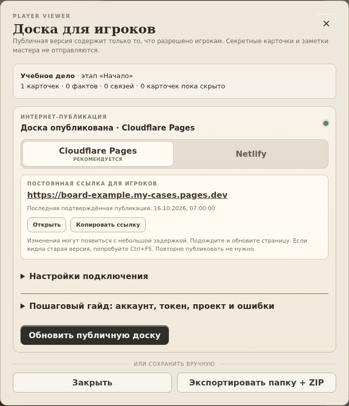

# Cloudflare Pages: публикация Detective Board

Версия: 1.0.0-beta.3.6. Инструкция проверена по документации Cloudflare и результатам настройки пользователя 15–16 октября 2026 года.

## Перед началом

Мастеру нужны Detective Board, интернет, электронная почта и бесплатный аккаунт Cloudflare. Для этого способа не требуется покупать домен, подключать платный план или добавлять банковскую карту. Игрокам достаточно браузера.

Если аккаунта ещё нет, на странице Cloudflare выберите **Sign up**, укажите почту и пароль и подтвердите почту по письму. После входа выберите аккаунт. Предложение добавить собственный домен можно пропустить: доска получит адрес `pages.dev`. Если видите создание Worker или покупку тарифа, вернитесь к инструкции ниже.

Первое подключение состоит из трёх действий: скопировать ссылку аккаунта, создать токен, опубликовать доску. После этого обычно достаточно одной кнопки **Обновить публичную доску**. Не отправляйте токен игрокам: им нужна только ссылка готовой доски.

## Что происходит при публикации

Мастер редактирует дело локально. Кнопка «Экспорт игрокам» → «Опубликовать через Cloudflare» отправляет статическую, доступную только для чтения версию текущей доски. Изменения не отправляются автоматически при редактировании.

Один Pages-проект может хранить несколько досок. Каждой доске приложение назначает собственную случайную ветку и постоянную ссылку вида `https://board-<идентификатор>.<проект>.pages.dev`. Обновление дела А меняет содержимое по прежней ссылке А; дело Б остаётся прежним. Основной адрес `<проект>.pages.dev` для новых автоматических проектов не используется как ссылка доски.

Игрокам не нужны Detective Board, аккаунт Cloudflare или токен. Компьютер мастера после публикации можно выключить. Это снимок доски на момент публикации, а не совместное редактирование в реальном времени.

## 1. Аккаунт и полный Account ID

1. Зарегистрируйтесь или войдите в [панель Cloudflare](https://dash.cloudflare.com/).
2. Выберите нужный аккаунт. Если панель просит подтвердить почту или завершить регистрацию, выполните её инструкции.
3. Уже на домашней странице аккаунта скопируйте адрес из строки браузера. Он выглядит так: `https://dash.cloudflare.com/0123456789abcdef0123456789abcdef/home`.
4. В Detective Board откройте дело → **Экспорт игрокам → Cloudflare Pages**.
5. В первое поле вставьте ссылку целиком. Программа выделит 32-символьный ID. Можно вставить и сам ID.

Значение с многоточием из интерфейса Cloudflare не подходит. Переходить на другую страницу ради ID не требуется. Account ID не является секретом; API Token является.

*Учебная схема с вымышленным ID. Копируйте ссылку своего аккаунта, а не пример с картинки.*

## 2. Токен с минимальными правами

1. Нажмите **Где взять?** возле токена или откройте [My Profile → API Tokens](https://dash.cloudflare.com/profile/api-tokens).
2. Выберите **Create Token → Create Custom Token → Get started**.
3. Token name: `Detective Board`.
4. В Permissions добавьте одну строку:

   | Категория | Разрешение | Уровень |
   |---|---|---|
   | Account | Cloudflare Pages | Edit |

5. В Account Resources выберите **Include → Specific account → ваш аккаунт**. Он должен совпадать с Account ID из первого поля.
6. Не добавляйте DNS, Billing, Workers Scripts или доступ ко всем аккаунтам. Global API Key не нужен.
7. IP-фильтр необязателен. При его использовании смена сети/VPN может сделать токен недоступным. Срок действия можно ограничить; после истечения потребуется новый токен.
8. Нажмите **Continue to summary → Create Token**.
9. Скопируйте сам токен в поле Detective Board. Не вставляйте команду curl, `Bearer`, кавычки или Global API Key. Cloudflare показывает секретное значение один раз.
10. Нажмите **Проверить подключение**. Программа сохранит настройки, запросит список проектов и проверит выбранный проект. Успех этой проверки доказывает доступ на чтение; право Edit окончательно проверяется при загрузке.

*Скриншот из официальной документации Cloudflare. Он показывает выбор Cloudflare Pages; после него выберите Edit. Расположение элементов в панели может отличаться.*

*Учебная схема итоговых значений. В последнем поле выберите свой аккаунт. Остальные разрешения не нужны.*

У Cloudflare также есть Account API Tokens через Manage Account → API Tokens. Они поддерживаются Pages API, если аккаунт позволяет их создавать. Программа проверяет доступ непосредственно к Pages; не использует пользовательский `/user/tokens/verify`, который не подходит всем типам токенов. Для первого подключения проще следовать одному пути выше и не смешивать два вида токенов.

**Важная граница прав:** разрешение Pages Edit относится к аккаунту, а не только к одной доске. Отдельная ветка изолирует обновления в приложении, но не сужает права самого токена до этой ветки. Не передавайте его игрокам.

## 3. Первая доска

1. Вернитесь к доске и проверьте режим **Глазами игроков**: открытые карточки, факты, поля, этапы и связи.
2. Откройте **Экспорт игрокам**. Проверьте название дела и количество экспортируемых элементов.
3. При первом подключении поле проекта можно оставить пустым. Нажмите **Сохранить настройки**, если пока не хотите ничего публиковать.
4. Нажмите **Опубликовать через Cloudflare**. Программа создаст статический Direct Upload проект и загрузит доску в её отдельную ветку.
5. Дождитесь сообщения **Доска опубликована** и блока **Постоянная ссылка для игроков**. Под ним появится время последней подтверждённой публикации. Сохранение настроек и проверка подключения сами по себе доску не публикуют.
6. Нажмите **Открыть** и проверьте результат. Затем **Копировать ссылку** и отправьте её игрокам.

После успешной публикации настройки подключения сворачиваются. Чтобы поменять аккаунт, проект или токен, раскройте **Настройки подключения**. Поле токена можно оставлять пустым, если программа сообщает, что он сохранён.

Ссылка публичная: любой, кому она стала известна, может её открыть. Случайный идентификатор и запрет индексации не являются авторизацией игроков. Эта версия не добавляет пароль или Cloudflare Access.

*Снимок интерфейса версии 1.0.0-beta.3.5 на учебных данных. Адрес и дело на изображении вымышлены.*

## 4. Если автоматическое создание проекта не работает

Ошибка `8000000` сама по себе не доказывает неправильность токена. Приложение сохраняет введённые данные и показывает запасной путь; не повторяет создание пять раз подряд.

1. В Cloudflare откройте **Workers & Pages → Create application**.
2. Перейдите в раздел **Pages**. В некоторых вариантах интерфейса ссылка называется **Looking to deploy Pages?**.
3. Выберите **Upload assets / Drag and drop your files**. Нужен Pages Direct Upload, а не Worker и не Git-интеграция.
4. В Detective Board нажмите **Экспортировать папку + ZIP**. Он содержит только версию для игроков.
5. В панели Cloudflare задайте имя проекта латиницей с цифрами/дефисами и загрузите содержимое папки либо ZIP. Для ручного drag-and-drop — до 1000 файлов и 25 MiB на файл. Завершите **Deploy site**.
6. Скопируйте **имя проекта** (например `my-cases`) из его настроек в поле № 3 Detective Board. Можно вставить основной адрес `my-cases.pages.dev`, если поддомен совпадает с именем проекта. Если Cloudflare добавил к поддомену случайный суффикс, берите именно имя из панели.
7. Нажмите **Проверить подключение**, затем **Опубликовать**.

Приложение создаст отдельную ветку для текущей доски. Адрес ручной production-публикации останется доступен отдельно. Для следующих обновлений используйте ссылку, которую показывает Detective Board.

Нельзя автоматически переключить Direct Upload проект на Git-интеграцию; для Git создаётся другой проект. Detective Board сознательно отклоняет проекты с Git или Functions, чтобы не смешивать доски с посторонним сайтом и его обработчиками.

## 5. Несколько дел и обновления

| Действие | Результат |
|---|---|
| Создать новое дело и опубликовать | Новый случайный адрес в общем проекте |
| Обновить существующее дело | Прежний адрес, другие дела не меняются |
| Переименовать дело | Адрес сохраняется |
| Нажать обновление без изменений | Новая загрузка не отправляется |
| Импортировать дело, ID которого уже существует | Импорт получает новый ID и новую привязку публикации |
| Восстановить резервную копию на том же компьютере | Существующие ID продолжают использовать местные привязки |
| Перенести backup на другой компьютер | Дела переносятся; токены и привязки не входят в backup. После подключения появятся новые ссылки |
| Изменить аккаунт или проект для дела | Создаётся новая ветка; прежняя публикация сама не удаляется |
| Удалить дело локально | Публичная версия в Cloudflare остаётся |

Настройки аккаунта общие, привязки досок отдельные. При переключении аккаунта программа не использует токен предыдущего аккаунта. Проект последнего успешного подключения подставляется для новых досок. Можно выбрать другой Direct Upload проект вручную.

После изменения дела откройте его экспорт и нажмите **Обновить публичную доску**. Игрокам достаточно обновить страницу. Если Cloudflare ещё обрабатывает загрузку, кнопка становится **Проверить публикацию**. Она проверяет ранее начатую операцию, не создавая новую. Если во время ожидания вы изменили доску, сначала завершите проверку, затем нажмите обновление ещё раз.

### Если сайт показывает прежнюю версию

Уже открытая страница игрока сама не меняется: после вашей публикации игрок должен обновить её. В проверке пользователя новая версия иногда появлялась примерно через полминуты. Это наблюдение, а не обещанный Cloudflare срок. Подождите и обновите страницу; на Windows можно попробовать **Ctrl+F5**. Повторная публикация из-за этой задержки не нужна.

Убедитесь, что открыта **постоянная ссылка из Detective Board**. В панели Cloudflare рядом могут быть основной адрес проекта и адрес конкретной версии. Адрес отдельной версии со случайным префиксом сохраняет старый снимок; он не предназначен для последующих обновлений.

Если долго остаётся прежняя версия, откройте постоянную ссылку в приватном окне и проверьте последний deployment в Cloudflare. Для сообщения об ошибке достаточно версии Detective Board, текста сообщения и скриншота статуса. Не присылайте API Token или файл настроек целиком.

### Как понимать статус в программе

| Статус | Что делать |
|---|---|
| Настройки сохранены · доска ещё не опубликована | Нажмите «Опубликовать через Cloudflare» |
| Ожидается подтверждение публикации | Нажмите «Проверить публикацию» позже; повторной загрузки не будет |
| Доска опубликована | Скопируйте постоянную ссылку; при задержке обновите страницу позже |
| Изменений нет | Текущая версия уже отправлена; новая загрузка не выполнялась |
| Не удалось скопировать ссылку | Выделите адрес в блоке над кнопками и скопируйте вручную |

При ожидании обновления прежняя подтверждённая ссылка остаётся видна. Зелёный статус означает подтверждение публикации Cloudflare, а не проверку того, что каждый браузер уже получил новую страницу.

### Переход с ранней Beta 3

Ранняя Beta 3 загружала всё в `main`. Candidate 2 переводит такие доски в отдельные ветки и показывает предупреждение о новой ссылке. Старый адрес остаётся доступным до удаления соответствующих старых развёртываний. Разошлите игрокам новую ссылку из приложения. Это предотвращает перезапись одной доски другой в общем проекте.

## 6. Бесплатные лимиты и расходы

Приложение использует статический Pages Direct Upload. Оно не включает Functions, Workers, R2, KV, D1, платные планы или покупку домена и не вызывает API оплаты. Существующие платные услуги вашего аккаунта этим не отключаются.

| Ограничение | Что это значит |
|---|---|
| Статические запросы | Cloudflare документирует бесплатные неограниченные запросы к статике |
| Размер одного файла | До 25 MiB; приложение проверяет до загрузки |
| Текущий формат Detective Board | Один HTML со встроенными изображениями; вся экспортируемая доска должна помещаться в 25 MiB |
| Число файлов Pages Free | До 20 000 на сайт; ручной drag-and-drop ограничен 1000 |
| Проекты | Мягкий лимит 100 на аккаунт; несколько досок используют один проект |
| Сборки | В таблице Pages Free указано 500 сборок в месяц |
| API и защита от злоупотреблений | Возможны временные ограничения; приложение показывает ошибку, не покупает повышение лимита |

**Про 500:** таблица limits описывает Git-сборки, обзор Pages называет 500 deploys/month. Для нашего Direct Upload готового HTML не стоит выдавать ни «точно 500 загрузок», ни «безлимитные публикации» за однозначно установленное правило. Планируйте умеренную ручную публикацию, учитывайте ответ API и актуальные условия Cloudflare. Счётчик «осталось N бесплатных публикаций» в приложении отсутствует, поскольку достоверных данных для него нет.

Уменьшить большой экспорт можно сокращением числа открытых фотографий или их размеров. Мастерские скрытые карточки не увеличивают публичный HTML. Сжатый ZIP не обходит лимит: Cloudflare ограничивает распакованный файл.

## 7. Хранение настроек и токена

Файл настроек: `%APPDATA%\Detective Board\settings\publish-settings.json` на Windows. Папку можно открыть через **Как пользоваться → Данные и обновления → Открыть папку данных**.

Запись настроек атомарная; ошибка чтения повреждённого файла не приводит к его перезаписи пустыми настройками. Настройки сохраняются отдельной кнопкой и перед сетевыми операциями. Ошибка публикации их не стирает. Несохранённые значения остаются в окне до закрытия приложения; для сохранения между запусками нажмите соответствующую кнопку.

Токен обрабатывается в основном процессе Electron и шифруется средствами ОС (`safeStorage`, на Windows — DPAPI). Если защищённое хранилище недоступно, токен остаётся только в памяти до закрытия программы. Открытого текстового резервного режима нет. Старый plaintext-токен ранней Beta 3 переносится в защищённое хранилище либо память и удаляется из настроек.

Это защищает секрет на диске, но не от вредоносных программ, уже работающих под вашей учётной записью. Не публикуйте токен в чатах, Issues и скриншотах. Программа не включает его в Player Viewer, диагностику и резервные копии дел. Не отправляйте кому-либо файл настроек целиком.

**Забыть токен** удаляет местную копию для выбранного аккаунта, сохраняя ссылки. Для отзыва самого токена: Cloudflare → My Profile → API Tokens → нужный токен → Delete. При утечке отзовите его и создайте новый.

## 8. Ошибки

| Сообщение | Что проверить |
|---|---|
| Неверный Account ID | Вставьте целиком ссылку домашней страницы аккаунта; 32 символа, без многоточия |
| Неверный формат токена | Вставьте секретное значение без curl/Bearer/кавычек |
| 401/403, нет доступа | Тот ли аккаунт, Pages → Edit, срок действия, IP-фильтр, отзыв токена |
| 404, проект не найден | Имя проекта и аккаунт. Программа не создаёт замену удалённому проекту сама |
| 8000000 | См. ручное создание проекта выше; по коду нельзя надёжно определить причину |
| 429 | Подождите несколько минут; не нажимайте публикацию многократно |
| Ошибка сети или 30 секунд без ответа | Интернет/VPN/доступ к api.cloudflare.com; настройки сохранены |
| Публикация ещё обрабатывается | Нажмите «Проверить публикацию», в том числе после перезапуска |
| Не удалось однозначно найти запрос | Откройте Deployments в панели Cloudflare. Программа не повторяет неопределённый POST вслепую. Проверьте, появился ли нужный deployment; если он был удалён вручную, воспользуйтесь описанным ниже сбросом ожидания |
| Ошибка завершения deployment | Предыдущая версия остаётся; повторите публикацию после устранения ошибки Cloudflare |
| HTML больше 25 MiB | Уменьшите публичные изображения/объём доски, а не только ZIP |
| Ошибка чтения настроек | Закройте программу и сохраните повреждённый файл отдельно; не удаляйте data/store.json. Восстановите настройки из собственной копии или настройте заново |

### Сброс ожидания после проверки в панели

Если неопределённый запрос так и не появился в Cloudflare либо вы удалили его вручную, после проверки Deployments нажмите **Сбросить ожидание…** и подтвердите действие. Сброс не отменяет запрос на сервере. Следующее нажатие публикации отправит новую версию. Если старый запрос всё же завершится позже, возможна дополнительная версия: сбрасывайте ожидание только после проверки.

## 9. Снятие с публикации и старые версии

Cloudflare сохраняет отдельные неизменяемые адреса версий. Обновление постоянной ссылки не гарантирует удаления старых данных. Если вы ошибочно раскрыли информацию, одной повторной публикации недостаточно: удалите соответствующие старые deployments в панели Cloudflare. Уже скачанные игроками копии отозвать невозможно.

Чтобы снять одну доску с публикации, откройте её Pages-проект → Deployments, определите ветку по ссылке `board-…` и удалите все deployments этой ветки. Не удаляйте общий проект: он содержит другие доски. Местная привязка при этом остаётся; последующая публикация может снова сделать доску доступной. Для старых production-версий ранней Beta 3 отдельно проверьте историю `main`.

## Источники

- [Pages Direct Upload: создание проектов и branch aliases](https://developers.cloudflare.com/pages/get-started/direct-upload/)
- [Pages limits](https://developers.cloudflare.com/pages/platform/limits/)
- [Обзор Pages, формулировка о deploys](https://developers.cloudflare.com/pages/)
- [Бесплатные статические запросы и тарификация Functions](https://developers.cloudflare.com/pages/functions/pricing/)
- [Preview aliases и исторические адреса](https://developers.cloudflare.com/pages/configuration/preview-deployments/)
- [Создание API token](https://developers.cloudflare.com/fundamentals/api/get-started/create-token/)
- [Токен для Pages Direct Upload](https://developers.cloudflare.com/pages/how-to/use-direct-upload-with-continuous-integration/)
- [Pages REST API](https://developers.cloudflare.com/pages/configuration/api/)
- [Electron safeStorage](https://www.electronjs.org/docs/latest/api/safe-storage)

- [Кэширование и обновление страниц](https://developers.cloudflare.com/pages/configuration/serving-pages/)
- [Источник скриншота настройки токена](https://developers.cloudflare.com/pages/how-to/use-direct-upload-with-continuous-integration/)

## Большие доски и изображения

При добавлении изображения программа проверяет его тип и размеры: PNG, JPEG, WebP или GIF, исходный файл до 20 МиБ, до 32 мегапикселей и 16 000 пикселей по стороне. Затем уменьшает его до 1200 px по длинной стороне и не более 180 КиБ в сохранённом представлении. GIF становится неподвижной картинкой; исходный файл на диске не изменяется.

Старые картинки не сжимаются автоматически. В окне «Экспорт игрокам» виден примерный объём данных и кнопка «Уменьшить изображения». Она уменьшает картинки текущей доски после подтверждения; Ctrl+Z отменяет изменение. Мелкие надписи могут потерять чёткость: для критичных деталей сохраняйте исходники отдельно.

Лимит Cloudflare — 25 МиБ на весь файл, включая текст, изображения и код просмотра. Размер данных в окне приблизительный, точный размер проверяется перед отправкой. Количество карточек само по себе лимит не определяет. Нагрузочная проверка 100 разных картинок и 99 связей описана в SECURITY-AUDIT.md.

«Сохранено» означает, что локальная запись завершена. При ошибке нажмите на статус сохранения для повтора; программа не выйдет из доски и не закроет окно, пока правки не сохранены.
