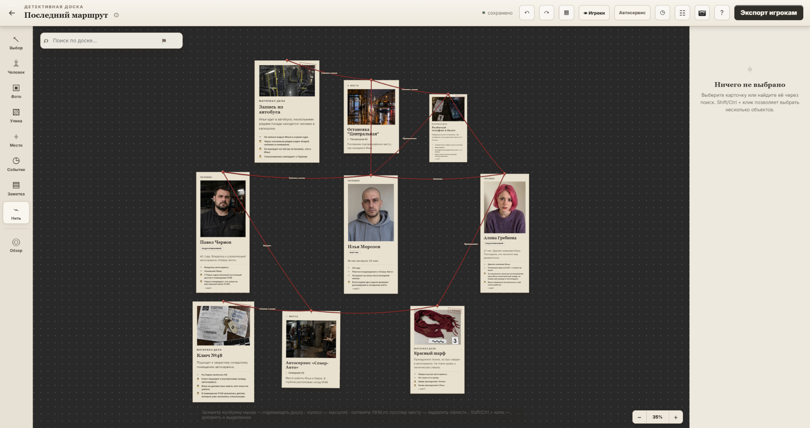
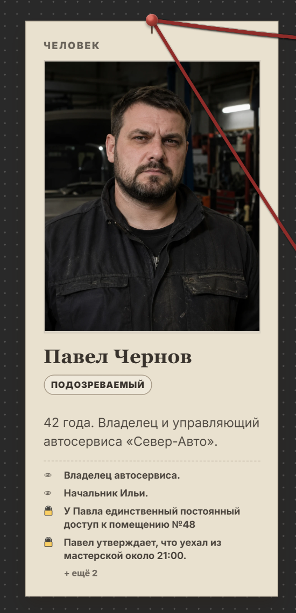
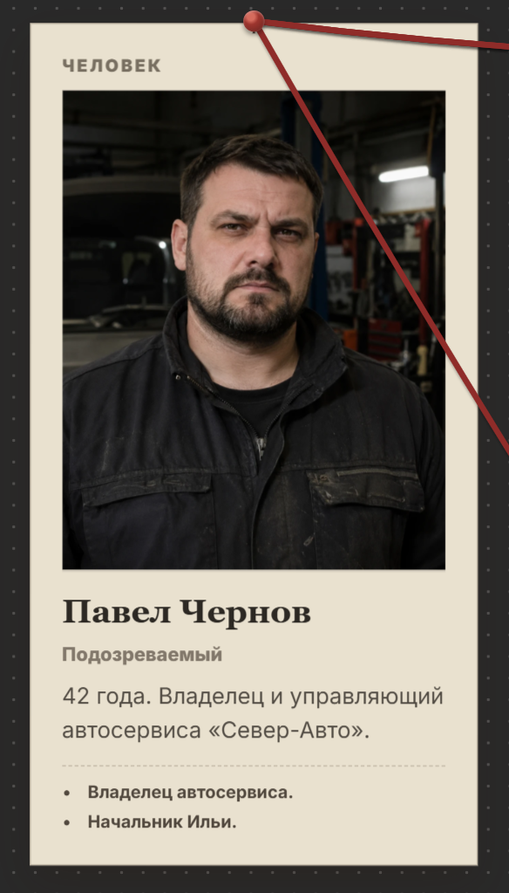
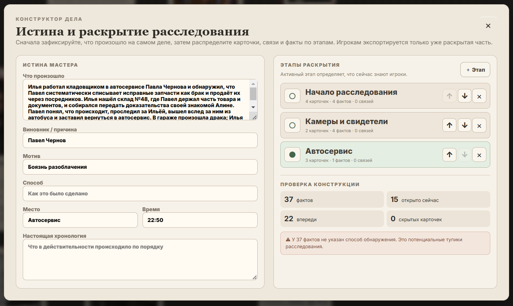
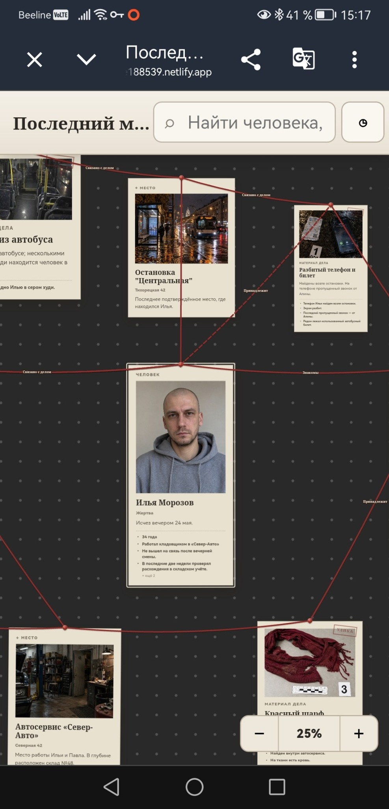
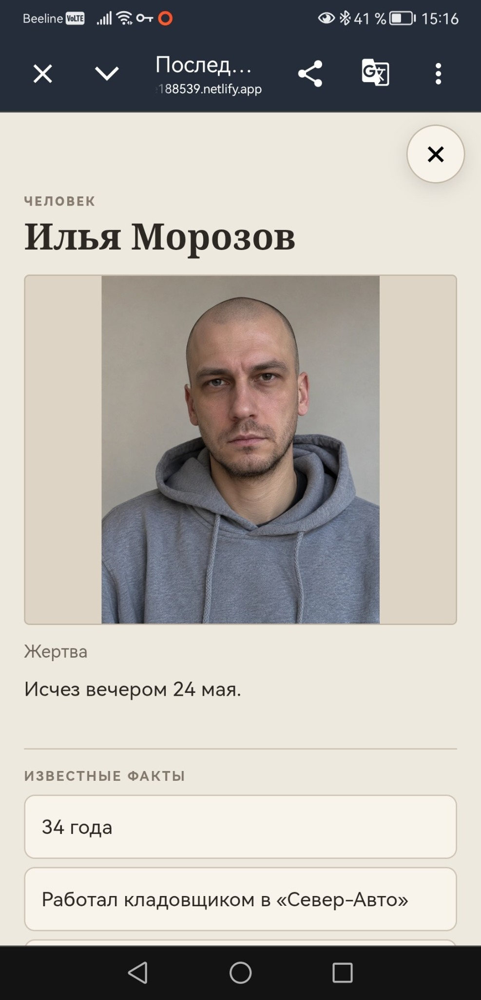

# Detective Board

**Detective Board** — локальный конструктор детективных расследований для мастеров настольных ролевых игр.

Мастер собирает полную картину дела у себя на компьютере: персонажей, места, события, улики, факты и связи. Затем постепенно открывает игрокам только ту часть расследования, которую они уже узнали, и при необходимости публикует отдельную интерактивную read-only доску для телефона или браузера.

> **Текущий релиз:** 1.0 Beta 3 · сборка 1.0.0-beta.3.6 
> **Платформа:** Windows 10/11  
> **Статус:** публичное бета-тестирование

## Скачать

### **[Скачать Detective Board 1.0 Beta 3 для Windows](https://github.com/peach-evgeny/detective-board/releases/download/v1.0.0-beta.3.6/Detective-Board-1.0.0-beta.3.6-Windows.zip)**

Распакуйте архив и запустите `Detective-Board-1.0.0-beta.3.6.exe`. Node.js, npm и отдельная установка зависимостей не нужны.

[Страница релиза и SHA-256](https://github.com/peach-evgeny/detective-board/releases/tag/v1.0.0-beta.3.6)

> Windows SmartScreen может показать предупреждение «Неизвестный издатель»: публичная бета пока не подписана коммерческим code-signing сертификатом.

## Идея

Detective Board строится вокруг двух параллельных слоёв:

- **Истина мастера** — полная версия произошедшего, включая виновника, мотив, настоящую хронологию и скрытые факты.
- **Знания игроков** — только та часть расследования, которая уже раскрыта на текущем этапе.

Одна и та же доска поэтому может выглядеть по-разному для мастера и игроков. Мастер заранее строит преступление целиком, а затем постепенно открывает карточки, факты и связи по мере прохождения игры.

## Как это выглядит

### Большая доска расследования

Карточки людей, мест, улик и событий можно свободно размещать на большой схеме, соединять нитями и постепенно превращать в полноценную карту расследования.

  

### Одна карточка — два уровня знания

<table>
<tr>
<td width="50%" align="center"><strong>Что видит мастер</strong></td>
<td width="50%" align="center"><strong>Что видят игроки</strong></td>
</tr>
<tr>
<td></td>
<td></td>
</tr>
</table>

Мастер может хранить на карточке скрытые факты, которые ещё не должны быть известны игрокам. Режим **«Глазами игроков»** сразу показывает, как эта же информация выглядит с их стороны.

### Сначала проектируется само расследование

В **Конструкторе дела** мастер фиксирует настоящую версию событий, виновника, мотив, место, время и хронологию, а затем распределяет карточки, связи и факты по этапам раскрытия.

  

### Player Viewer на телефоне

Игрокам можно отправить отдельную интерактивную read-only доску. Она работает в браузере и адаптирована под мобильный экран: по доске можно перемещаться, масштабировать её и открывать карточки с подробностями.

<table>
<tr>
<td width="50%" align="center"><strong>Доска игроков</strong></td>
<td width="50%" align="center"><strong>Подробности карточки</strong></td>
</tr>
<tr>
<td align="center"></td>
<td align="center"></td>
</tr>
</table>

## Основные возможности

- бесконечная детективная доска;
- карточки людей, мест, событий, улик, фотографий и заметок;
- нити, подписи, направления и узлы-разветвления;
- быстрое создание связи через `ПКМ → Добавить связь`;
- создание новой уже связанной карточки через ПКМ;
- факты внутри карточек с отдельной видимостью для игроков;
- источники фактов — через какие объекты игроки могут получить информацию;
- этапы постепенного раскрытия расследования;
- «Истина мастера» и настоящая хронология дела;
- режим **«Глазами игроков»**;
- поиск, теги, фильтры, таймлайн и фокус по связям;
- Undo/Redo, копирование, слои и групповое выделение;
- PNG-снимок текущего вида или всей доски;
- отдельный интерактивный **Player Viewer** для игроков;
- полноэкранные карточки и мобильная навигация Viewer;
- публикация Player Viewer через Cloudflare Pages с отдельной постоянной ссылкой каждого дела;
- Netlify как дополнительный вариант и ручной экспорт;
- локальное автосохранение;
- резервные копии и импорт старых данных;
- настройки доски: цвет фона, точек, новых нитей, новых карточек и текста.

## Быстрый старт

1. Создайте новое дело.
2. Откройте **«Конструктор дела»** и зафиксируйте, что произошло на самом деле.
3. Добавьте персонажей, места, улики и события.
4. Соедините связанные элементы нитями.
5. Добавьте факты и укажите, какие из них видны игрокам.
6. Создайте этапы расследования: например, `Начало → Свидетели → Автосервис → Развязка`.
7. Проверьте результат через режим **«Глазами игроков»**.
8. При необходимости опубликуйте Player Viewer и отправьте игрокам ссылку.

По доске можно перемещаться через `Space + мышь` или **зажатое колёсико мыши**. Обычная прокрутка колеса меняет масштаб.

Полное руководство: **[USER_GUIDE.md](USER_GUIDE.md)**.

## Что изменилось в Beta 3

- **Cloudflare Pages** — основной способ публикации: независимые доски, постоянные ссылки, сохранённые настройки и понятные ошибки.
- **Пошаговый гайд** с иллюстрациями: Account ID, права токена, выбор проекта, первая публикация и обновление.
- **Большие доски:** изображения не пересоздаются при каждом выборе карточки; старые картинки уменьшаются по явной команде с отменой.
- **Надёжное сохранение:** статус после записи на диск, повтор при ошибке, ожидание сохранения при обычном закрытии.
- **Защита данных:** проверка импорта и изображений, изоляция локального API, резервная копия перед удалением доски.

Это обновление подготовлено на сборке **1.0.0-beta.3.6**. [Полное описание выпуска](RELEASE_NOTES_v1.0.0-beta.3.6.md).

Для первого подключения начните с **[гайда Cloudflare](PUBLISHING.md)**. В ZIP есть автономная иллюстрированная версия `CLOUDFLARE-GUIDE.html`.

## Безопасное обновление

Начиная с Beta 2 дела хранятся в одной постоянной системной папке **Detective Board**, а не внутри папки конкретной версии программы.

В программе откройте `? Как пользоваться → Данные и обновления`, чтобы:

- открыть папку данных;
- создать резервную копию;
- восстановить резервную копию;
- импортировать старый `store.json` из Preview/Beta.

Перед обновлением рекомендуется: сделать backup → закрыть старую версию → запустить новую → проверить свои дела → только после этого удалять старую папку или EXE.

Подробная инструкция: **[UPDATING.md](UPDATING.md)**.

## Player Viewer и секреты мастера

Player Viewer — отдельная read-only версия расследования. Скрытые мастерские данные не просто маскируются интерфейсом: они **не включаются в публичный экспорт**.

В Viewer не должны попадать мастерские заметки, скрытые карточки, скрытые факты, скрытые связи, закрытые поля и раздел «Истина мастера».

Перед публикацией рекомендуется один раз включить **«Глазами игроков»** и проверить, что игрокам открыта именно нужная информация.

## Интернет нужен?

Для создания и редактирования дела — **нет**. Мастерская часть работает локально.

Интернет требуется только для действий, которые сами используют внешний сервис, например автоматической публикации Player Viewer в Cloudflare или Netlify.

## Сообщить об ошибке

Это публичная бета, поэтому особенно полезны реальные тесты во время подготовки и проведения НРИ.

Перед созданием Issue подготовьте шаги воспроизведения, ожидаемое и фактическое поведение, скриншот или короткое видео и диагностику из `? Как пользоваться → Скопировать диагностику`.

**[Создать Issue](https://github.com/peach-evgeny/detective-board/issues/new/choose)**

Если проблема связана с потерей или исчезновением данных, укажите это в самом начале сообщения и не удаляйте старые папки приложения.

## Известные ограничения

См. **[KNOWN_ISSUES.md](KNOWN_ISSUES.md)**.

Главные ограничения Beta 3:

- Windows-сборка пока не подписана сертификатом;
- готовые пользовательские сборки macOS/Linux пока не выпускаются;
- публикация зависит от выбранного хостинга, его API и лимитов;
- опубликованная доска — снимок, а не лайв-сессия;
- ссылка публична, пароля игроков нет;
- очень большие изображения и чрезвычайно крупные доски всё ещё могут потреблять заметно больше памяти.

## Конфиденциальность

Мастерские проекты сохраняются локально. В текущей бете нет собственной системы аккаунтов или облачной синхронизации Detective Board.

Подробнее: **[PRIVACY.md](PRIVACY.md)**.

## Документация

- [Руководство пользователя](USER_GUIDE.md)
- [Безопасное обновление и резервные копии](UPDATING.md)
- [Как тестировать Beta 3](TESTING_GUIDE.md)
- [FAQ](docs/FAQ.md)
- [Известные ограничения](KNOWN_ISSUES.md)
- [История изменений](CHANGELOG.md)
- [Как сообщать об ошибках и помогать тестированию](CONTRIBUTING.md)
- [Описание Beta 3](RELEASE_NOTES_v1.0.0-beta.3.6.md)
- [Публикация через Cloudflare](PUBLISHING.md)
- [Аудит и измерения производительности](SECURITY-AUDIT.md)

---

**Detective Board 1.0 Beta 3** — публичная тестовая версия. Если приложение пригодилось в реальной игре, особенно полезно рассказать, какой сценарий вы строили и где интерфейс начал мешать работе мастера.
